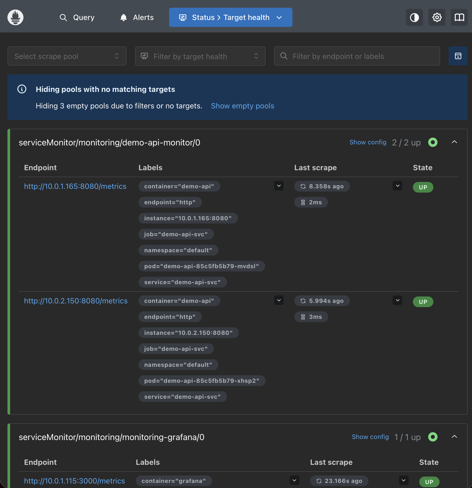
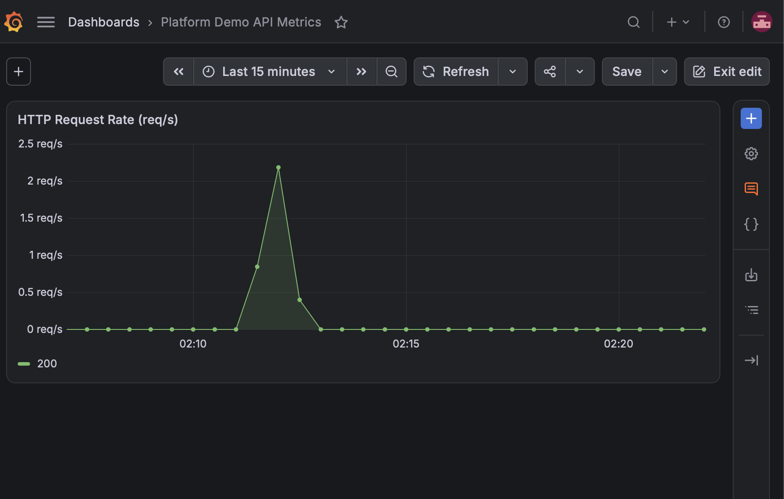
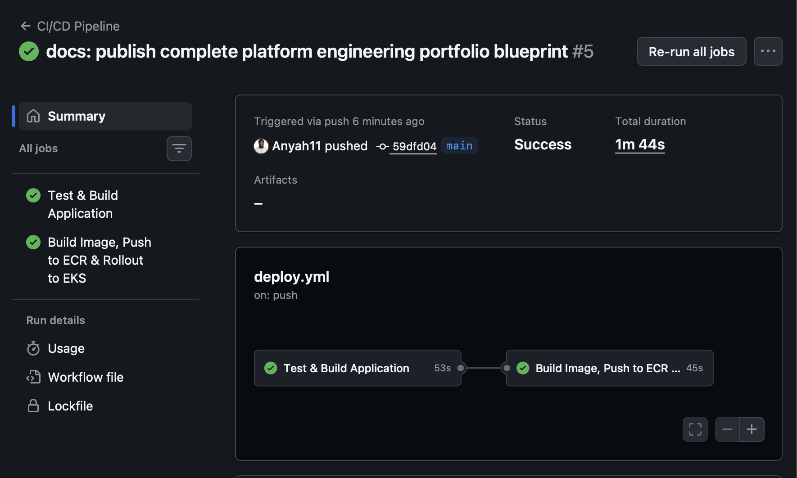
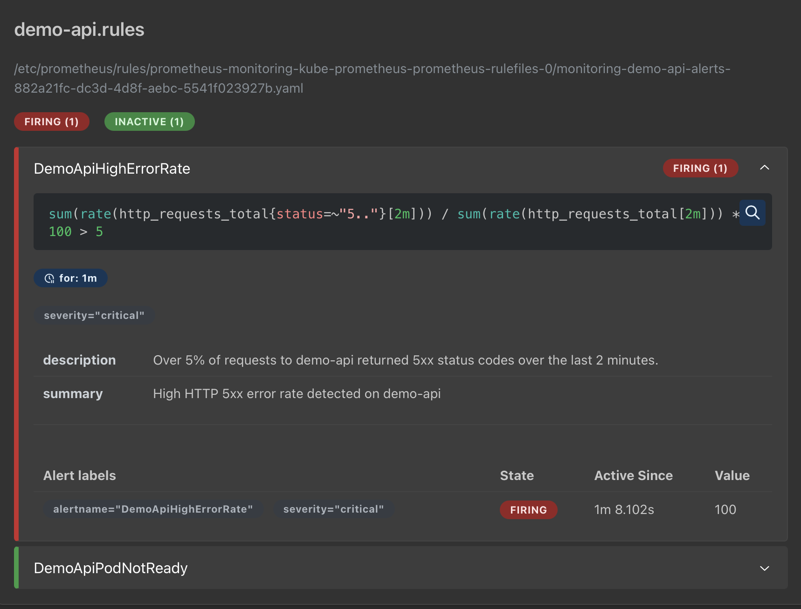

# Production Platform & SRE Blueprint

[](https://github.com/Anyah11/production-platform-blueprint/actions/workflows/deploy.yml)
[](https://kubernetes.io/)
[](https://www.terraform.io/)
[](https://aws.amazon.com/eks/)
[](https://prometheus.io/)
[](https://grafana.com/)

An enterprise-grade, cloud-native platform engineering reference blueprint implementing Infrastructure as Code (IaC), GitOps-oriented automated delivery with AWS IAM OIDC keyless authentication, and an end-to-end Prometheus Operator observability stack running on Amazon EKS.

---

## Architecture Topology

```text
                               +-----------------------------+
                               |        GitHub Actions       |
                               | (OIDC Short-Lived JWT Auth) |
                               +--------------+--------------+
                                              |
                     +------------------------+------------------------+
                     |                                                 |
                     v                                                 v
        +-------------------------+                       +-------------------------+
        |     Amazon ECR Repo     |                       |     Amazon EKS v1.31    |
        |   (OCI Container Build) |                       |     (AWS us-east-1)     |
        +-------------------------+                       +------------+------------+
                                                                       |
                          +--------------------------------------------+--------------------------------------------+
                          |                                                                                         |
                          v                                                                                         v
              +-----------------------+                                                                 +-----------------------+
              |   default Namespace   |                                                                 |  monitoring Namespace |
              |  - demo-api Pods (2)  |<----------------- Scrape /metrics (15s interval) ----------------|  - Prometheus Pods    |
              |  - demo-api-svc       |                                                                 |  - Grafana Dashboards |
              |  - ServiceMonitor     |------------------ Evaluates 5xx error rules ------------------->|  - Alertmanager       |
              +-----------------------+                                                                 +-----------------------+
```

---

## Technical Highlights & Engineering Decisions

### 1. Keyless AWS OIDC CI/CD (Zero Long-Lived Static Keys)
- Configured an AWS IAM OpenID Connect (OIDC) identity provider (`token.actions.githubusercontent.com`) paired with an IAM role (`github-actions-deployer-role`).
- Scope-restricted using the IAM condition claim `token.actions.githubusercontent.com:sub` to only allow execution from `repo:Anyah11/production-platform-blueprint:*`.
- Eliminates `AWS_ACCESS_KEY_ID` and `AWS_SECRET_ACCESS_KEY` storage, satisfying CIS Benchmark and AWS security best practices.

### 2. Multi-Stage Containerization & Hardening
- **Go REST Microservice:** Compiled using Go with endpoints for `/`, `/healthz` (liveness/readiness), `/metrics` (Prometheus exposition), and `/fault` (synthetic HTTP 500 error generation).
- **Security:** Built via multi-stage `Dockerfile` with `CGO_ENABLED=0` and stripped debug symbols (`-ldflags="-s -w"`). Deployed on minimal `alpine:3.20` running as unprivileged user `appuser` (UID `10001`).

### 3. Observability & SRE Incident Response
- **Prometheus Operator:** Deployed using `kube-prometheus-stack` Helm chart.
- **Dynamic Service Discovery:** Managed via a `ServiceMonitor` CRD (`demo-api-monitor`) targeting `demo-api-svc` across worker nodes.
- **PrometheusRule Alerting:** Authored declarative alert definitions (`DemoApiHighErrorRate`) that calculate the 5xx percentage rate via PromQL and trigger Alertmanager upon breaching 5% over a 2-minute window.

---

## Proof of Work & Verification Telemetry

### 1. Prometheus Automated Target Discovery
Prometheus successfully discovering both active application pods across cluster nodes (`2 / 2 UP`):



### 2. Live Telemetry & Traffic Spike in Grafana
Real-time traffic telemetry and request rate visualization configured in Grafana using PromQL query `sum(rate(http_requests_total[1m])) by (status)`:



### 3. Keyless GitHub Actions Deployment
Automated pipeline execution performing Go tests, multi-stage image packaging, Amazon ECR upload, and rolling deployment to EKS via IAM OIDC:



### 4. Synthetic Fault Injection & Alert Evaluation
To validate incident detection mechanisms without waiting for organic production failures, the application exposes a `/fault` endpoint that returns HTTP 500 and increments `http_requests_total{status="500"}`:

1. **Traffic Injection:** Generated a burst of synthetic 5xx requests to breach the 5% error threshold:
   ```bash
   for i in {1..100}; do curl -s -o /dev/null -w "%{http_code}\n" http://localhost:8080/fault; sleep 0.1; done
   ```
2. **Prometheus Alerting State Transition:** Prometheus evaluated the PromQL error-ratio expression, transitioning `DemoApiHighErrorRate` from `Inactive` to `Pending` and finally to `Firing` once the error condition persisted past the 1-minute evaluation threshold:



---

## Project Structure

```text
├── .github/
│   └── workflows/
│       └── deploy.yml            # OIDC automated build, test, and EKS rollout pipeline
├── app/
│   ├── Dockerfile                # Multi-stage, non-root unprivileged container build
│   ├── go.mod                    # Go dependencies definition
│   ├── go.sum                    # Dependency checksum verification
│   └── main.go                   # Go HTTP service instrumented with Prometheus & /fault injection
├── docs/
│   └── screenshots/              # Portfolio proof-of-work captures
│       ├── github-actions-success.png
│       ├── grafana-http-rate.png
│       ├── prometheus-alert-firing.png
│       └── prometheus-targets-up.png
├── k8s/
│   ├── deployment.yaml           # Deployment (2 replicas, probes) and ClusterIP Service
│   ├── servicemonitor.yaml       # CoreOS ServiceMonitor for automated metric scraping
│   └── prometheus-rule.yaml      # SRE alerting rule for 5xx error rate spikes
└── terraform/
    ├── github_oidc.tf            # AWS IAM OIDC Provider and deployer role definition
    ├── main.tf                   # Multi-AZ VPC and Amazon EKS cluster configuration
    ├── variables.tf              # Region and cluster sizing inputs
    └── outputs.tf                # Cluster endpoints and OIDC role ARNs
```

---

## Deployment & Setup Guide

### 1. Prerequisites
- AWS CLI v2 configured with active credentials
- Terraform `>= 1.5.0`
- `kubectl` matching cluster version (`v1.31`)
- Docker CLI or Docker Desktop

### 2. Infrastructure Provisioning
```bash
cd terraform
terraform init
terraform apply -auto-approve
aws eks update-kubeconfig --region us-east-1 --name platform-eks-cluster
```

### 3. Monitoring Stack Installation
```bash
helm repo add prometheus-community https://prometheus-community.github.io/helm-charts
helm repo update
helm install monitoring prometheus-community/kube-prometheus-stack \
  --namespace monitoring \
  --create-namespace
```

### 4. Deploy Application & Observability Custom Resources
```bash
kubectl apply -f k8s/deployment.yaml
kubectl apply -f k8s/servicemonitor.yaml
kubectl apply -f k8s/prometheus-rule.yaml
```

---

## Cost Optimization & Resource Teardown

To avoid recurring AWS charges for the EKS Control Plane ($0.10/hr), NAT Gateways ($0.045/hr + data), and EC2 worker nodes:

```bash
# 1. Unlink Kubernetes load balancers and services
kubectl delete -f k8s/ --ignore-not-found=true
helm uninstall monitoring -n monitoring --ignore-not-found=true

# 2. Terminate all cloud infrastructure via Terraform
cd terraform
terraform destroy -auto-approve
```
